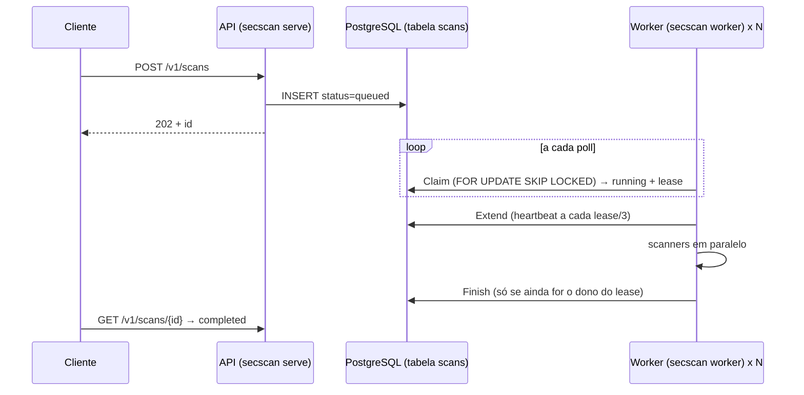

# 🛡️ SecScan — Security Scanner em Go

Scanner de segurança concorrente, em **arquitetura em camadas**, com **CLI**, **API REST**,
**persistência em PostgreSQL**, **fila de jobs com workers separados**, **métricas Prometheus** e imagem **Docker distroless**.
O núcleo usa só a biblioteca padrão do Go; a única dependência externa é o driver `pgx`, isolado no adaptador de storage.

> ⚠️ **Uso ético:** execute apenas contra sistemas que você possui ou para os quais tem autorização por escrito.
> Para testes públicos e legais, use `scanme.nmap.org`.

## O que ele verifica

| Módulo | Verificações |
|--------|--------------|
| `port-scan` | Varredura TCP concorrente (worker pool), banner grabbing passivo, classificação de risco (Telnet, SMB, RDP, Redis, MongoDB…) |
| `tls-check` | Cadeia/hostname do certificado, expiração, SHA-1, TLS 1.0/1.1 habilitados, versão/cipher negociados |
| `http-headers` | HSTS, CSP, X-Frame-Options, nosniff, Referrer/Permissions-Policy, vazamento de versão (`Server`, `X-Powered-By`), flags de cookies |

Cada achado traz **severidade, evidência e correção sugerida**.

## Início rápido

```bash
# Ajuste o module path para o seu usuário do GitHub (uma vez):
go mod edit -module github.com/SEU-USUARIO/secscan
grep -rl 'seu-usuario/secscan' --include='*.go' . | xargs sed -i 's#seu-usuario/secscan#SEU-USUARIO/secscan#g'

make deps            # baixa o driver pgx e gera o go.sum (necessário uma vez)
make test            # vet + testes com -race
make build           # gera bin/secscan

./bin/secscan scan -host scanme.nmap.org -ports 22,80,443 -format markdown
./bin/secscan scan -host exemplo.com -format json -fail-on high   # exit 1 se houver HIGH+ (ótimo para CI)
```

### Com Docker

```bash
docker compose up --build     # API :8080, worker, PostgreSQL (volume pgdata), alvo "target", Prometheus :9090
docker compose up -d --scale worker=3   # 3 workers consumindo a mesma fila

curl -s -X POST localhost:8080/v1/scans \
  -H 'X-API-Key: dev-key-change-me' -H 'Content-Type: application/json' \
  -d '{"host":"target","ports":"80,443,8080"}'
# -> 202 Accepted {"id":"ab12...","status":"queued",...}  (um worker pega o job em ~2s)

curl -s -H 'X-API-Key: dev-key-change-me' localhost:8080/v1/scans/<id>
curl -s -H 'X-API-Key: dev-key-change-me' 'localhost:8080/v1/scans/<id>/report?format=markdown'
curl -s localhost:8080/metrics
```

## API

| Método | Rota | Descrição |
|--------|------|-----------|
| POST | `/v1/scans` | Cria varredura (`{"host","ports"}`) → `202` + `Location` |
| GET | `/v1/scans` | Lista varreduras |
| GET | `/v1/scans/{id}` | Detalhe/status |
| GET | `/v1/scans/{id}/report?format=text\|json\|markdown` | Relatório |
| GET | `/healthz` · `/metrics` | Saúde e Prometheus |

Autenticação por `X-API-Key` (variável `SECSCAN_API_KEY`).

## Configuração

| Variável | Padrão | Descrição |
|----------|--------|-----------|
| `SECSCAN_ADDR` | `:8080` | Endereço da API |
| `SECSCAN_API_KEY` | *(vazio)* | Se vazio, a API fica sem autenticação (aviso no log) |
| `SECSCAN_ALLOW_PRIVATE` | `false` | Permite alvos em loopback/redes privadas |
| `SECSCAN_DATABASE_URL` | *(vazio)* | URL do PostgreSQL. Se vazio, a API usa memória e executa no próprio processo (sem fila) |
| `SECSCAN_WORKER_CONCURRENCY` | `2` | Varreduras simultâneas por worker |
| `POSTGRES_PASSWORD` | `secscan-dev` | Senha do banco no compose — **troque fora de demos** (`.env`) |

## Segurança do próprio scanner

- **Proteção anti-SSRF:** bloqueia metadata de cloud (`169.254.169.254`), multicast e `0.0.0.0` sempre.
- Limite de portas por varredura, limite de corpo de requisição, timeouts no `http.Server`.
- Comparação de API key em tempo constante; imagem distroless, `nonroot`, `read_only`, `cap_drop: ALL`.
- CI com `go vet`, `-race`, `golangci-lint` (inclui `gosec`) e scan da imagem com **Trivy**.

## Arquitetura

Camadas `domain → application → infrastructure/interfaces`, com dependências apontando para dentro.
Detalhes, diagramas, ADRs e limitações conhecidas em [`docs/ARCHITECTURE.md`](docs/ARCHITECTURE.md).

```
cmd/secscan/            composition root (CLI + serve)
internal/domain/        entidades e portas (Scanner, ScanRepository)
internal/application/   Service, TargetPolicy, ParsePorts
internal/infrastructure scanners, storage (memória + PostgreSQL), report, observability
internal/interfaces/    httpapi (REST + middlewares)
```

## Roadmap

fila de jobs, exportação SARIF, OpenTelemetry, scanner de dependências (OSV). Veja a arquitetura.

## Persistência (PostgreSQL)

- Tabela `scans` (colunas escalares + `data JSONB` com o resultado completo), criada automaticamente por migrations embutidas (`internal/infrastructure/storage/migrations`).
- Os dados vivem no volume `pgdata`: sobrevivem a `docker compose down` e `up`. Para zerar: `docker compose down -v`.
- Testes de integração (`make test-db`): `docker compose up -d db`, publique a porta 5432 do `db` só localmente (`ports: ["5432:5432"]`) e rode. Cada teste usa um schema temporário e não toca nos seus dados.

## Fila de jobs e workers



- **Sem broker extra:** a fila é a própria tabela `scans`, usando `FOR UPDATE SKIP LOCKED` (workers concorrentes nunca pegam o mesmo job).
- **At-least-once com lease:** se um worker morre, o lease expira e outro reexecuta o job (até 3 tentativas); depois disso o job vira `failed`.
- **Um worker "zumbi" não corrompe dados:** `Finish` só grava se o worker ainda for o dono do lease.
- **Graceful shutdown:** no `SIGTERM` o worker para de reservar jobs e espera os atuais terminarem (até 30s).
- **Defesa em profundidade:** o worker revalida a política anti-SSRF antes de escanear (o DNS pode ter mudado desde o enfileiramento).
- Cada worker expõe `/healthz` e `/metrics` (porta 9100); o Prometheus descobre as réplicas via DNS.
- Sem `SECSCAN_DATABASE_URL`, nada muda: a API roda as varreduras no próprio processo (modo dev/CLI).
