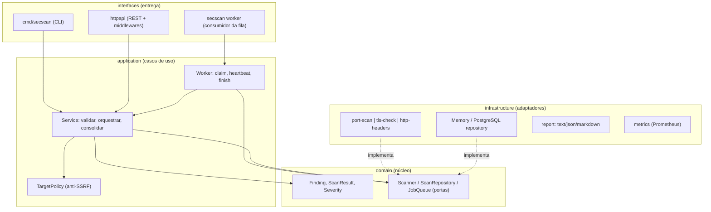

# Arquitetura do SecScan

## Visão em camadas

**Regra de dependência:** as setas apontam para dentro. `domain` não importa nada do projeto;
`application` só importa `domain`; `infrastructure` e `interfaces` dependem de `domain`/`application`.
O único lugar que conhece todas as peças é o *composition root* (`cmd/secscan/main.go`, função `buildService`).

## Fluxo de uma varredura

1. Interface recebe o alvo (CLI `scan` ou `POST /v1/scans`).
2. `TargetPolicy.Validate` resolve o DNS e **bloqueia** link-local/metadata (169.254.x.x), multicast e 0.0.0.0;
   loopback e redes privadas só com `SECSCAN_ALLOW_PRIVATE=true`.
3. **Modo fila (PostgreSQL):** a API só **enfileira** (`queued`) e responde `202`. Um **worker** reserva o job
   (`Claim`, com lease), revalida a política, renova o lease por heartbeat e dispara **todos os scanners em paralelo**.
   **Modo local (memória/CLI):** o próprio `Service` executa em goroutine.
4. Cada scanner devolve `[]Finding`; falha de um scanner vira aviso, não derruba os demais.
5. Achados são ordenados por severidade; o worker grava com `Finish` (exige ser dono do lease) e atualiza as métricas.

## Decisões de design (ADRs resumidos)

| # | Decisão | Motivo | Trade-off |
|---|---------|--------|-----------|
| 1 | Arquitetura em camadas / ports & adapters | Testabilidade e troca de infraestrutura sem tocar regras | Mais arquivos/interfaces |
| 2 | `Scanner` como interface | Adicionar módulos sem alterar o núcleo (Open/Closed) | — |
| 3 | Núcleo só com biblioteca padrão; única dependência externa é `pgx` | Superfície de ataque mínima; o driver fica isolado em `infrastructure/storage` e o domínio não o conhece | Router/metrics "na mão" |
| 4 | Worker pool no port scan | Controle de concorrência (evita esgotar FDs) | — |
| 5 | Scan assíncrono na API (202 + polling) | Varreduras demoram; evita timeouts HTTP | Cliente precisa fazer polling (webhooks ficam no roadmap) |
| 8 | PostgreSQL com resultado em JSONB + colunas indexadas | Persistência simples sem 5 tabelas; filtros por host/status/data continuam rápidos | Consultas profundas nos achados exigem operadores JSONB (índice GIN já criado) |
| 10 | **Fila sobre PostgreSQL** (`FOR UPDATE SKIP LOCKED`) em vez de Redis/RabbitMQ | Sem componente novo; enfileirar e persistir o resultado ficam no mesmo banco; fácil de operar e demonstrar | Throughput menor que um broker dedicado; consulta por *polling* (latência ~2s) |
| 11 | Semântica **at-least-once** com lease + heartbeat | Worker pode morrer a qualquer momento; o job é recuperado | Um job pode executar mais de uma vez (varredura é idempotente/somente leitura, então é seguro) |
| 12 | `Finish` condicionado ao dono do lease | Impede que um worker "zumbi" sobrescreva o resultado de quem assumiu | — |
| 9 | Troca de repositório por env (`SECSCAN_DATABASE_URL`) | Mesmo binário roda em dev (memória) e prod (Postgres) | — |
| 6 | Imagem distroless + non-root + `read_only` | Hardening de container | Sem shell para debug (use `docker debug`) |
| 7 | `InsecureSkipVerify` só no scanner TLS | Precisamos inspecionar certificados inválidos; a validação é refeita manualmente | Marcado com `//nolint:gosec` e comentado |

## Limitações conhecidas (honestidade técnica)

- **TOCTOU de DNS:** a política resolve o host antes; os scanners resolvem de novo ao conectar.
  Um DNS malicioso (rebinding) poderia trocar o IP entre as duas etapas. Mitigação futura: resolver uma vez e conectar por IP.
- **Polling:** workers consultam o banco a cada ~2s quando ociosos. Para latência menor, adicione `LISTEN/NOTIFY` do PostgreSQL; para volume alto, implemente `domain.JobQueue` sobre Redis/NATS (a interface já isola isso).
- **Sem prioridade nem cancelamento** de jobs, e sem rate limit por cliente/alvo.
- **Tentativas só cobrem falha de worker** (lease expirado). Se todos os scanners falham, o job termina como `failed` sem retry.
- **Migrations simples:** arquivos `CREATE ... IF NOT EXISTS` idempotentes. Para evolução de schema real, adote golang-migrate ou goose.
- **Sem rate limit** por cliente na API. Coloque atrás de um proxy/API gateway ou adicione um middleware.
- Port scan é TCP connect (sem SYN scan/raw sockets) — portável, porém mais "ruidoso".

## Como adicionar um novo scanner

1. Crie `internal/infrastructure/scanners/meuscanner.go` implementando `Name()` e `Scan(ctx, Target)`.
2. Registre-o em `buildService` (`cmd/secscan/main.go`).
3. Escreva o teste com `httptest`/`net.Listen`, como os existentes.

## Roadmap sugerido

- Webhooks de conclusão, `LISTEN/NOTIFY`, prioridade/cancelamento de jobs; migrations versionadas (goose)
- Scanner de dependências (leitura de `go.mod`/OSV API) e de segredos em repositórios
- Exportação SARIF (integra com GitHub Code Scanning)
- OpenTelemetry (traces) e dashboard Grafana
- Rate limiting, RBAC e trilha de auditoria
